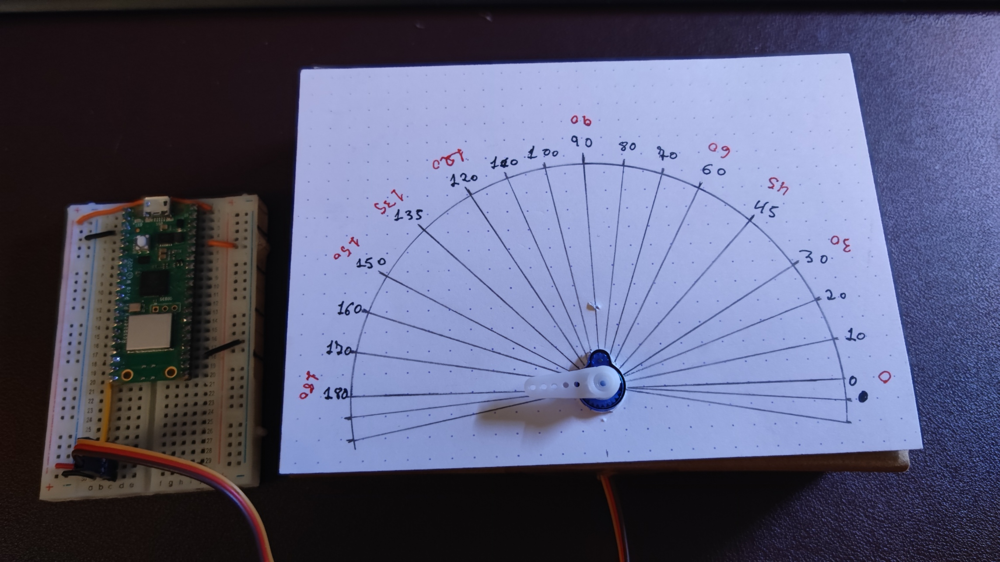

# 2627CL03_Servos - sin y con POO <u>clase en borrador</u>

Indice evolutivo del las clases del taller + libros y webs de referencia:

[GitHub - Jcspoza/26_27Prog_RobotCMMBML_Index: Indice - Taller Programacion y Robotica 2026 - 2027 en CMM Benito Martin Lozano · GitHub](https://github.com/Jcspoza/26_27Prog_RobotCMMBML_Index)

## Clase x : Robotica Servos- Resumen inicial

### Tópicos que se van a cubrir

1. Que es un servo 0-180º y como controlarlo con ondas cuadradas PWM
   
   1. Hoja de datos del servo mas típico de robotica [SG90](SG90_a.pdf)
   
   2. Básico sobre señal de control PWM

2. Calibración de servos 0-180º

3. Control de servo ( sin usar POO)

4. Iniciación a POO : Programación orientada a objetos

5. Control de servos con POO

#### Materiales necesarios

| Material      | Descripcion | Kit SF | Montaje |
| ------------- | ----------- | ------ | ------- |
| uC PICO       |             | SI     |         |
| Servo 0-180º  |             | SI     |         |
| Cables dupond |             | SI     |         |
| Protoboard    |             | SI     |         |

### Montaje usado en esta clase ServoM#1

Alimentar el servo a +5volt y conectar el cable de control del servo SIG al GPIO15 o pin 20 lado izquierdo de la PICO.


### Enlaces a tutoriales e información

| Tutorial                                                                                                                                  | Nivel  | Notas                                                           |
| ----------------------------------------------------------------------------------------------------------------------------------------- | ------ | --------------------------------------------------------------- |
| [Tutorial SF servo](https://docs.sunfounder.com/projects/pico-2w-kit/en/latest/component/component_servo.html)                            | Básico | programa : R2627_servo_demo.py, No usa duty_ns                  |
| [Luis Llamas - Clase servo avanzada](https://www.luisllamas.es/micropython-servomotores-pwm/)                                             | Medio  |                                                                 |
| https://learn.sparkfun.com/tutorials/hobby-servo-tutorial/                                                                                |        | Muy completo                                                    |
| https://robots-argentina.com.ar/didactica/manejo-preciso-de-servos-en-arduino-grados-y-milisegundos/                                      |        | Para explicar calibración                                       |
| [tutorial de POO en nuestra referencia Python 'el libro de Python'](https://ellibrodepython.com/programacion-orientada-a-objetos-python)  | Medio  | para explicar POO en Python, pero vale para micropython también |
| [Composición vs herencia en Python](https://realpython.com/inheritance-composition-python/)                                               | Medio  | Elección entre composición o herencia en POO en Python          |
| [clase servo simple](https://picockpit.com/raspberry-pi/es/how-to-control-servo-with-raspberry-pi-pico-w-and-pulse-width-modulation-pwm/) |        | Algo antiguo , clase servo simple                               |

### Programas importantes de la clase

| Programa                                                   | Montaje  | Objetivo                                                                                            | Notas                      |
| ---------------------------------------------------------- | -------- | --------------------------------------------------------------------------------------------------- | -------------------------- |
| [R2627_servo_demo.py](R2627_servo_demo.py)                 | ServoM#1 | Ver movimiento de un servo de 0º a 180º SIN calibrar                                                | Sin calibrar               |
| [R2627_servo_calibra_v1_0.py](R2627_servo_calibra_v1_0.py) | ServoM#1 | Calibrar un servo de 0º a 180º con 3 parámetros                                                     |                            |
| [R2627_servo_in_deg_v1_4.py](R2627_servo_in_deg_v1_4.py)   | ServoM#1 | Fijar posición de un servo entre 0º a 180º un servo con precisión usando los valores de calibración | Calibrado con 3 parámetros |
| [LibServo180v1.py](LibServo180v1.py)                       | ServoM#1 | Libreria para manejar un servo 500 a 2500 us hecha en 2023                                          | Calibrado con 3 parámetros |
|                                                            |          |                                                                                                     |                            |

---

## Documentación de soporte - antigua

[Clases 6 y 7 de robotica CMM BML de 2023](./doc/CMM_MK_Servo.pdf)

## Que es un servo 0-180º y como controlarlo con ondas cuadradas PWM

### Hoja de datos del servo mas típico de robotica [SG90](./doc/SG90_a.pdf)

[Explicaciones sobre la hoja de datos del SG90 ](./doc/datasheet_SG90_explicado.pdf)

[Entender las implicaciones de la dead band](./doc/SG90_deadband.pdf)

### Básico sobre señal de control PWM

Ver cualquiera de las tutoriales

[Historia de porque se usan señales PWM para le control de los servos ](./doc/Historia_PWM_servos.pdf)

## Calibración de servos 0-180º

Estudiar y ejecutar programa

[R2627_servo_calibra_v1_0.py](R2627_servo_calibra_v1_0.py)

Es conveniente hacer un pequeño montaje de cartón y papel para poder calibra el servo , ver foto con un ejemplo



## Control de servo ( sin usar POO)

Estudiar y ejecutar programa

[R2627_servo_in_deg_v1_4.py](R2627_servo_in_deg_v1_4.py)

---

## Iniciación a POO : Programación orientada a objetos

Las entidades de la vida real se pueden modelar en Python como objetos, y a eso se le denomina **Programación orientada a objetos POO**

La definición de un modelo para ciertos objetos se denomina clase. —> es solo la definición NO crea ningún objeto, es como un molde

**Las clases tienen atributos y métodos**

- Los **atributos** son como propiedades dentro de las clases, que se guardan en variables. se definen con la sintaxis de las variables, dentro del cuerpo de definición una clase.

- Los **métodos**son como operaciones en los objetos de la case. Se definen con la sintaxis de las funciones, dentro del cuerpo de definición una clase.

- Hay un método especial que es el **constructor**: 
  El método constructor se define mediante la función `__init__()`  y establece explícitamente los valores predeterminados de los atributos, o asigna los valores de los atributos
  esenciales a través de argumentos de método `__init__()`

Ver el [tutorial  de POO en nuestra referencia Python 'el libro de Python'](https://ellibrodepython.com/programacion-orientada-a-objetos-python)

## Control de servos con POO

### Decisiones de diseño: composición vs herencia + parámetros del constructor

Consulta la intro a la POO en Python en 

[tutorial de POO en nuestra referencia Python 'el libro de Python'](https://ellibrodepython.com/programacion-orientada-a-objetos-python)

Para un proyecto de robótica con  **servos** en **MicroPython en Raspberry Pi Pico 2**, suele ser buena idea encapsular el servo en una clase que:

- Inicialice el PWM.
- Permita mover el servo a un ángulo (0-180°).
- Permita calibrar cada servo con sus microsegundos concretos  0º y 180º e incluso a 90º ( si no es lineal)
- Limite automáticamente los valores válidos.
- Oculte los detalles del PWM al resto del programa.

#### Composición vs herencia

Pero antes de empezar hay que decidir si la clase servo  heredara de la clase PWM o simplemente tomara algunos componentes de PWM. 

**Herencia ( is-a)** "Un servo es un PWM."

```
class Servo(PWM):
```

**Composición (has-a)** "Un servo tiene un PWM."

```
class Servo:
    self._pwm = PWM(...)
```

La segunda es mas correcta. De hecho, este es un ejemplo clásico para explicar cuándo usar herencia y cuándo composición: un servo utiliza internamente un generador PWM, pero no es un generador PWM en sí mismo. Por eso la mayoría de bibliotecas 'servo' suelen optar por la composición.

Mas técnicamente, hay un regla para eso el Principio de Sustitución de Liskov (LSP) ver  [Liskov substitution principle](https://realpython.com/solid-principles-python/#liskov-substitution-principle-lsp).

La formulación clásica de Barbara Liskov dice algo parecido a:

> Si S es un subtipo de T, entonces los objetos de T pueden ser reemplazados por objetos de S sin alterar las propiedades correctas del programa.

En términos más prácticos:

> Si una clase hereda de otra, debe poder usarse en cualquier lugar donde se espere la clase base sin que nada "extraño" ocurra.

En el caso concreto de servo, un objeto `Servo` debería poder utilizarse en cualquier lugar donde el programa espere un `PWM`.

```
def configurar_pwm(pwm):
    pwm.freq(1000)
    pwm.duty_ns(500000)

configurar_pwm(mi_servo)
```

Como mi_servo hereda de PWM, esto es legal. Pero ¿qué ocurre?

```
mi_servo.freq(1000)
```

Un SG90 ya no recibe una señal válida. La clase deja de comportarse como un servo. Has roto sus invariantes. 

Un concepto muy importante en LSP es el de invariante. **Un servo típicamente necesita: 'frecuencia = 50 Hz' ,** pero en un PWM se puede cambiar libremente la frecuencia.

**Regla práctica para robótica**

Cuando modeles componentes físicos:

Correcto:

- Robot tiene motores

- Motor tiene PWM

- Brazo tiene servos

- Servo tiene PWM

**Sospechoso:**

- Servo es un PWM

- Robot es un Motor

- Sensor es un Pin

Porque normalmente los componentes físicos usan otros componentes de más bajo nivel, pero no son sustituibles por ellos. Por eso, desde el punto de vista de LSP, Servo(PWM) es técnicamente posible, pero conceptualmente débil, mientras que Servo que contiene un PWM suele ser el diseño más correcto.

#### Parámetros del constructor

 """
        pin_num : GPIO conectado al servo
        c0degus  : pulso correspondiente a 0°, obtenido en calibración
        c180degus  : pulso correspondiente a 180°, obtenido en calibracion
        c90degus  : pulso correspondiente a 90°, obtenido en calibracion
            o mitad entre 0 y 180º
    """

### Libreria Servo v1

Es la libreria que hice en 2023

### Libreria Servo v2

---

Todo: movimiento suave
